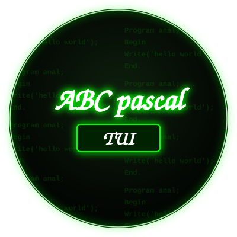

-blue)

---

[](README_UA.md) [](README_RU.md)

---



## DESCRIPTION

abc-pascal-tui is an IDE for Pascal based on the PascalABC.NET compiler, utilizing a Python-based TUI (Text User Interface).

## REQUIREMENTS

Before installing the IDE, ensure you have Python, Mono, Git, and the Textual library installed. DotNet is not required yet (it is needed for running binaries that do not work correctly under Mono).

<p align="center">
  
</p>

<p align="center">
  
</p>

## Instructions for Termux

```bash
pkg install mono -y
```

```bash
pkg install python -y
```

```bash
pkg install git -y
```

```bash
pip install textual 
```

(It is advisable to install DotNet, but it is not required.)

```bash
pkg install dotnet-runtime-8.0
```

```bash
git clone https://github.com/kuzmak161-creator/abc-pascal-tui
```

```bash
cd abc-pascal-tui
```

### Installation

After cloning, run the installer from the root of the repository:

```bash
bash install.sh
```

The script will ask you to select a language (English / Русский / Українська), then:

- Copy all project files (including the tui script) to `/usr/share/abc-pascal-tui` (or `$PREFIX/share/abc-pascal-tui` in Termux if `$PREFIX` is set).
- Create the `pascal-tui` command in `/bin` (or `$PREFIX/bin`) that runs the installed tui script.

After installation, you can run the IDE from anywhere using the command:

```bash
pascal-tui
```

Settings will be saved in:

```
~/.config/abc-pascal-tui/settings.json
```

## Instructions for Debian

(tested on Arm versions and mx linux x86_64)

```bash
sudo apt install mono-complete
```

```bash
sudo apt install git -y
```

```bash
sudo apt install python3 -y
```
(--break-system-packages is needed to install without venv.)
```bash
pip3 install textual --break-system-packages
```

(It is advisable to install DotNet, but it is not required.)

```bash
curl -sSL https://dot.net/v1/dotnet-install.sh | bash -s -- --runtime dotnet --channel 8.0
```

```bash
git clone https://github.com/kuzmak161-creator/abc-pascal-tui.git
```

```bash
cd abc-pascal-tui
```

Run the installer (root is required, because files are installed to `/usr/share` and `/bin`):

```bash
sudo bash install.sh
```

---

## Updating

Update the IDE folder:

```bash
cd ~/abc-pascal-tui && git pull
```

Then run the installer again (`bash install.sh` in Termux, `sudo bash install.sh` on Debian):

```bash
bash install.sh
```

Updates are released less frequently in official releases.

---

## Compiler Build Guide

- 🇬🇧 [In English (EN)](docs/BUILD.md)
- 🇷🇺 [На русском (RU)](docs/BUILD_RU.md)
- 🇺🇦 [Українською (UA)](docs/BUILD_UA.md)

---

## License

- **PascalABC.NET Compiler** — GNU Lesser General Public License v3 (LGPL v3) https://github.com/pascalabcnet/pascalabcnet

The interface code (tui) is distributed under the terms of the MIT License.
